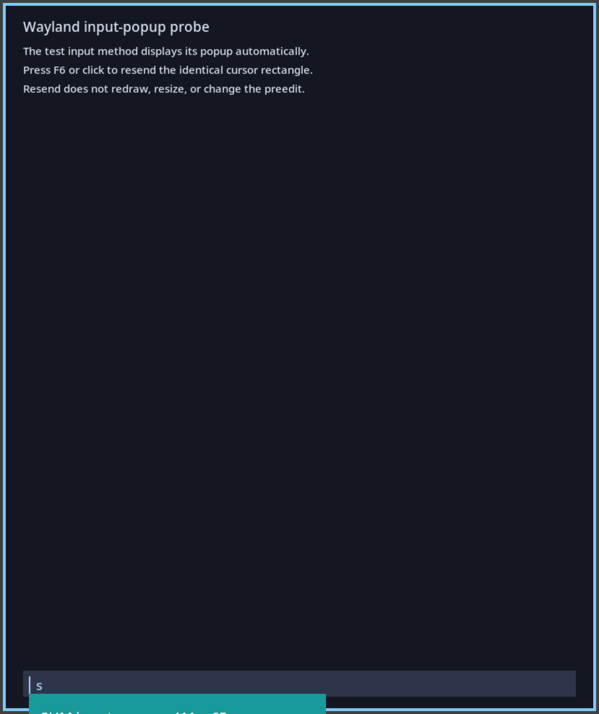
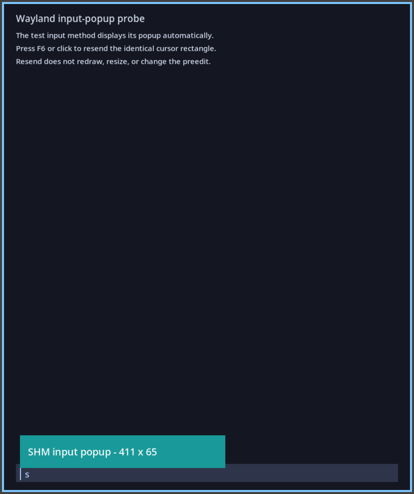

# Wayland input-popup placement reproducer

A minimal text-input-v3 client and input-method-v2 popup for investigating placement after the previous input client exits. Uses C, Wayland SHM buffers and Cairo.

See [REPORT.md](REPORT.md) for the observed results and suspected source-level cause.

## Requirements

Linux, Niri, a C compiler, pkg-config, Wayland client/Cairo/xkbcommon development packages, Python 3 and Pillow. Generated protocol sources are included with their original license notices.

## Run

From a terminal in an existing Wayland session:

```sh
bash build.sh
python3 run.py
```

The script starts the installed Niri as a separate nested compositor. It opens four input clients in sequence, retaining the same input-method popup, and captures its position before and after repeating the cursor rectangle. Leave the nested window untouched during the test (approximately 15 seconds).

The launcher prints the results directory (`/tmp/ime-popup-repro-*`). It contains screenshots, `results.jsonl`, compositor output and client protocol-event logs. The nested compositor is stopped when the test finishes; the main compositor and input method are left running.

A `complete` result means the sequence ran successfully, not that the placement bug occurred. Compare the before/after screenshots. Row intervals in the results identify the teal popup in physical pixels; `null` means it was not detected.

## Recorded example

On Niri 26.04, the first client showed the popup correctly. After that client exited, all three subsequent clients showed a clipped popup; repeating the identical cursor rectangle restored its position.

| Before repeating the cursor rectangle | After |
| --- | --- |
|  |  |

Measurements are in [evidence/results.jsonl](evidence/results.jsonl). Automatic cursor replay is disabled.
